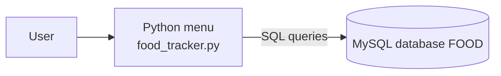
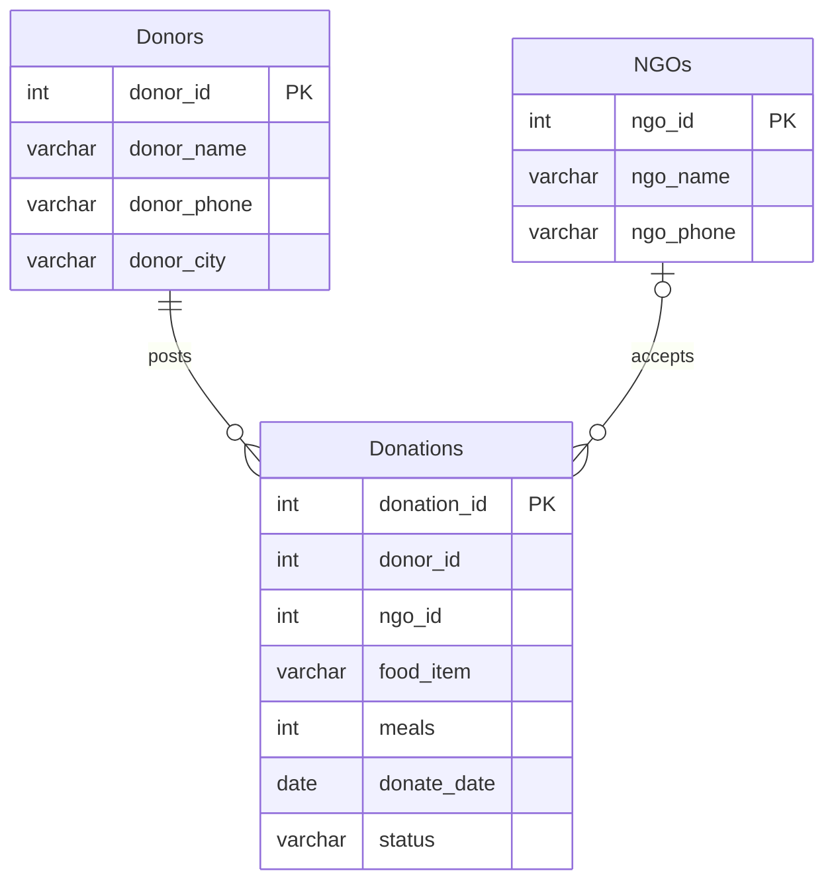

# Food Donation Tracker

A console application that connects food donors (hotels, caterers, households) with NGOs that can collect surplus food. Donors post available meals, NGOs accept a pickup, and the program reports how many meals were rescued each month.

- **Front end:** Python (`food_tracker.py`), a text menu
- **Back end:** MySQL database `FOOD` (structure in `schema.sql`)



## Features

| Menu option | What it does |
|---|---|
| 1. Add Donor | Registers a donor and shows the Donor ID |
| 2. Add NGO | Registers an NGO and shows the NGO ID |
| 3. Post Food | A donor posts a food item and number of meals |
| 4. View Available Food | Lists donations not yet accepted, with donor contact details |
| 5. NGO Accepts Pickup | An NGO claims a donation (only one NGO can claim it) |
| 6. Monthly Meals Report | Total meals accepted, grouped by month |
| 7. Pickup Details | Shows which NGO accepted which donation |

## Database design



A donation starts as `Available` and becomes `Accepted` when an NGO claims it.

## Requirements

- Python 3
- MySQL (or MariaDB) installed and running on your computer

## How to run

```bash
# 1. Install the MySQL connector
pip install -r requirements.txt

# 2. Open food_tracker.py and replace your_password_here
#    with your MySQL root password (line 2). Do not commit your real password.

# 3. Run. The database and tables are created automatically on first run.
python food_tracker.py
```

`schema.sql` holds the same table definitions the program creates. It is there so the database can be read or created in MySQL Workbench or the `mysql` command line (`mysql -u root -p < schema.sql`).

A typical session: add a donor (note the Donor ID), add an NGO (note the NGO ID), post food using the Donor ID, then accept it from option 5 with the NGO ID and the Donation ID shown in option 4.

## Project structure

```
food-donation-tracker/
├── food_tracker.py    Python front end
├── schema.sql         Database structure (same as the program creates)
├── requirements.txt   Python dependency
├── .gitignore
└── README.md
```

## Known limitations

This is a learning project. Before real-world use, note that:

- Queries are built with `.format()`, so special characters in names (for example an apostrophe) cause an error, and the program is open to SQL injection. Parameterised queries (`%s` placeholders) fix this.
- IDs entered are not checked against the database, so an unknown NGO ID can "accept" food and appear in the monthly report but not in Pickup Details. Foreign keys and an existence check fix this.
- Phone numbers longer than 10 characters, and non-numeric IDs, end the program with an error message.
- The database password is typed into the source file; reading it from an environment variable is safer.

## Possible next steps

- Parameterised queries, foreign keys and input validation
- A `Collected` status so pickups can be marked complete
- Expiry time for food safety, and a city filter for available food

## Project report

Guide: Smt. Saranya P, Computer Science Teacher.

The Class XII project report (10 sections: Abstract to Bibliography) is in [`docs/`](docs/) as Word and PDF.

## Extra files

| File | What it is |
|---|---|
| `food_tracker.py` | The original program, unchanged |
| `extras/food_tracker_improved.py` | Corrected version: parameterised queries, input checks, foreign keys; reads the password from the `MYSQL_PASSWORD` environment variable |
| `extras/food_tracker_pure_sql.sql` | The same logic written entirely in SQL (views and stored procedures) |

Never commit a real MySQL password. Keep the placeholder `your_password_here` in `food_tracker.py`.
